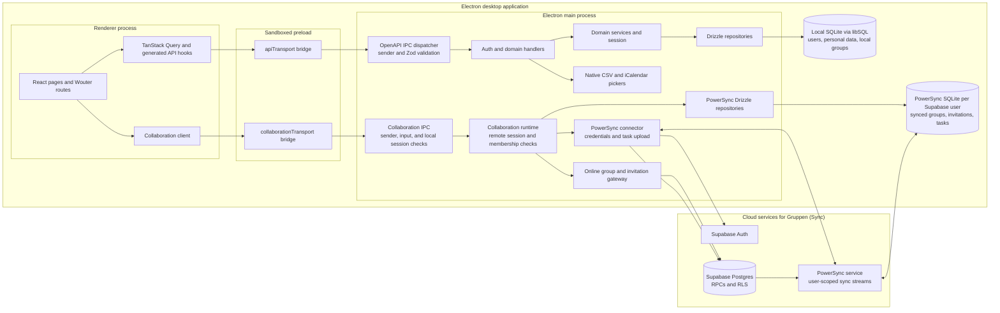
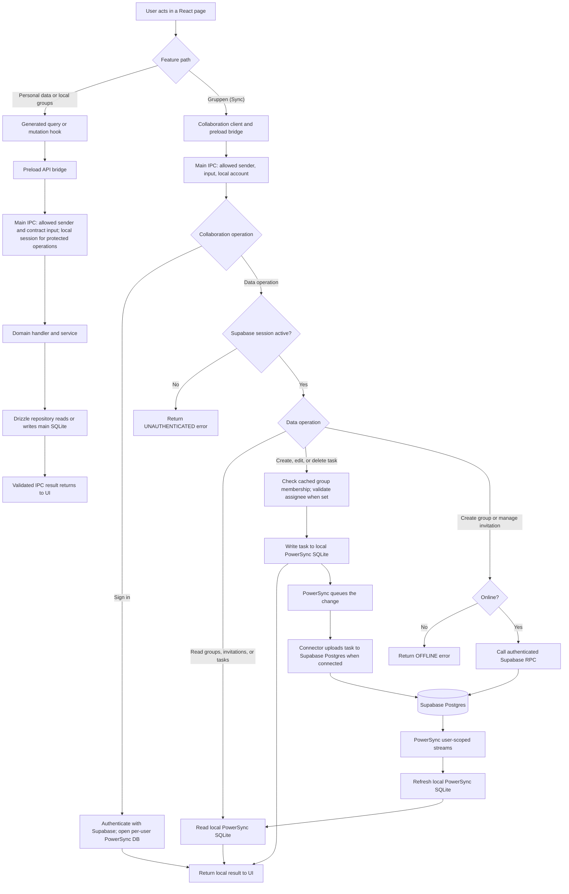

# StudyPlan architecture

These diagrams describe the normal desktop app startup and the features wired into its UI. The
`src/main/spikes` runners are invoked only by test flags (or the explicit
`POWERSYNC_SPIKE_ENABLED` setting) and are outside the main application path.

For a file-by-file explanation of the synchronized groups feature, see the
[sync collaboration guide](sync-collaboration-guide.md).

## Component diagram

The two SQLite files have different purposes. The main database is initialized and migrated before
the window opens. It stores local accounts, events, grades, timetable entries, study programs, and
the original local group feature. The separate PowerSync database is opened after a Supabase sign-in
and is named for that remote user. It holds the five synchronized tables: `profiles`,
`study_groups`, `group_members`, `group_invitations`, and `group_tasks`. The original local groups
are not synchronized or migrated into those tables.

`api/openapi.yaml` generates the shared API contract and renderer hooks used by the local path.
The collaboration path uses its own typed IPC contract. Both cross the isolated preload bridge;
neither renderer path accesses Node or either database directly.

## Request and data flow

Task writes return after the local PowerSync write; upload and delivery to other members occur
later when connected. Group creation, profile search, invitation sending, and invitation responses
require an online RPC. The PowerSync streams filter group data by membership and invitation data by
participant. Supabase RLS protects the remote tables and task upload. The local StudyPlan account
must be signed in before any collaboration IPC operation; Supabase sign-in is an additional session.
The Supabase session is kept in memory, so the user signs in again after an app restart.

## Code map

| Area                                            | Source                                                                                                  |
| ----------------------------------------------- | ------------------------------------------------------------------------------------------------------- |
| Startup, process boundaries, handler wiring     | `src/main/index.ts`, `src/preload/index.ts`, `src/renderer/src/App.tsx`                                 |
| Generated local API and validation              | `api/openapi.yaml`, `src/main/ipc/api-dispatcher.ts`, `src/renderer/src/api/generated/`                 |
| Local session, services, repositories, database | `src/main/auth/`, `src/main/services/`, `src/main/repositories/`, `src/main/db/`                        |
| Collaboration IPC and runtime                   | `src/shared/collaboration/ipc.ts`, `src/main/collaboration/ipc.ts`, `src/main/collaboration/runtime.ts` |
| PowerSync storage and upload                    | `src/main/collaboration/database.ts`, `repositories.ts`, `connector.ts`                                 |
| Online RPCs and stream rules                    | `src/main/collaboration/online-gateway.ts`, `spike/powersync-groups/sync-streams-v4.yaml`               |
