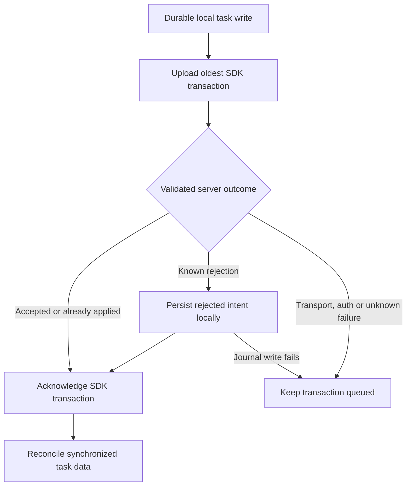

# Collaboration uploads: P1 implementation and evidence

Implemented on 2026-09-26 in the primary checkout, starting from `8068c7e`.
Verification was captured before the implementation commit. The prior task-audit migration is preserved.
This completes the three upload correctness items from [the test-led plan](p1-hardening-plan.md).

## Changes and their reasons

| Finding                                         | Implementation                                                                                        | Evidence                                                                           |
| ----------------------------------------------- | ----------------------------------------------------------------------------------------------------- | ---------------------------------------------------------------------------------- |
| P1-1: zero-row PATCH silently acknowledged      | Authenticated `upload_group_task` RPC returns an explicit missing-or-inaccessible rejection           | Z1/Z2 fast, real SQLite queue, SQL/RLS and two-user cloud checks                   |
| P1-2: permanent failure blocks unrelated writes | Save rejected intent in a local-only journal before acknowledging the SDK transaction                 | Q1–Q8, including journal write failure, restart and forced process exit            |
| P1-3: replay overwrites newer edits             | A private receipt and its task mutation commit together; matching retries return the recorded outcome | R1–R6, including lost PUT/PATCH/DELETE responses and concurrent duplicate requests |

The connector now delegates upload policy to `upload.ts`; `upload-failures.ts` owns local journal
storage. Tests inject only transport outcomes and failure boundaries. Drizzle repositories continue
to write tasks locally; membership and invitation operations keep their online gateway.

There are still five synchronized domain tables. `collaboration_upload_failures` is local-only.
`private.group_task_upload_receipts` is remote metadata, excluded from the synchronization streams.
No additional sync engine or dependency was added.

## Acknowledgement and retry policy

Acknowledgement occurs only after every entry in the oldest local transaction is accepted or
durably recorded as rejected. A partially uploaded transaction can repeat its earlier requests;
receipts prevent repeated application. Remote task writes within a multi-operation local transaction
are not a single atomic remote transaction. Each operation has its own atomic task/receipt boundary.

The logical operation identity is `(authenticated user, persistent PowerSync client ID, CRUD entry
sequence)`. The client ID and queue sequence survive database restart. Different replicas can reuse
the same sequence without sharing an operation identity. Deleting the local database starts a new
replica identity.

PUT is create-only. A task-ID collision without a matching receipt is a conflict, not proof that
this operation was previously accepted. PATCH updates only supplied mutable fields, preserves
explicit nulls, and rejects a missing or inaccessible target. DELETE of an absent or hidden target
is a safe no-op; its outcome does not confirm access. A reused operation identity with a changed
payload is rejected. The existing audit trigger derives the accepted actor and timestamp.

Only the RPC's validated rejection codes are terminal. Authentication errors, transport errors,
unknown SQL/HTTP failures and unrecognized responses stay queued. Raw backend messages and
credentials are not written to the failure journal or shown by the status component.

## Durable rejected intent

The per-user local journal records operation identity, task/group IDs, operation kind, changed
fields, available desired task snapshot, reason and detection time. Previous-value tracking retains
the task's contents for queued deletions. The journal write commits before queue acknowledgement;
an idempotent insert and lookup recover an exit between those two boundaries.

After a task's operation is rejected, later queued operations for that task are retained as
`DEPENDENCY_REJECTED`. Unrelated tasks proceed. Rejected operations require a future explicit
retry after permission/data validation, resolving the dependency marker and assigning a new
operation identity. A new identity alone does not bypass the existing rejected-task marker.
There is no automatic retry
of rejected edits, conflict editor or journal-dismissal feature in this increment.

The synchronized-groups UI now distinguishes pending writes, transport failures and preserved
rejections. Expandable draft details remain available when the screen is reopened. The account
must sign in again after application restart, as before; the journal is loaded from that user's
database. The journal is not synchronized to another device or encrypted separately from SQLite.

## Test sequence and results

Before changing the connector, five regressions failed against the upload behavior at `8068c7e`:

| Case | Observed baseline failure                                                              |
| ---- | -------------------------------------------------------------------------------------- |
| Z1   | Queue acknowledgement occurred with zero durable rejection records                     |
| Q1   | Rejected A prevented valid B from reaching the modeled server                          |
| R1   | Retrying the partially accepted batch replaced Bob's newer title with Alice's original |
| R2   | Retrying PUT after a lost reply replaced Bob's later edit                              |
| R3   | Retrying PATCH after a lost reply replaced Bob's later edit                            |

The existing local happy-path smoke check passed at that baseline. Thus happy-path durability did
not detect these failure modes. The backend model retains both legacy REST behavior and the new
RPC behavior, so the regression arrangements can also be used when comparing the old connector.

Final verification:

| Command or check                       | Result and scope                                                                                                                         |
| -------------------------------------- | ---------------------------------------------------------------------------------------------------------------------------------------- |
| `npm run collaboration:test`           | 19 passing tests: transport/policy, replay, journal/ack faults, replica identities and static UI rendering                               |
| `npm run powersync:groups:test`        | 9 passing checks using actual Electron, PowerSync and SQLite; includes a separate child process exiting before acknowledgement           |
| `task-upload.sql`                      | Passed against deployed Postgres with authenticated/anonymous roles; fixtures roll back                                                  |
| `task-audit.sql`                       | Passed again; the prior actor, timestamp and identity protection remains effective                                                       |
| `npm run powersync:groups:cloud`       | 12 passing checks: original invitation/offline/audit path, Z1/Z2/Q1/R1–R4, concurrent duplicate HTTP calls and replica convergence       |
| `npm run typecheck`                    | Passed                                                                                                                                   |
| `npm run build`                        | Passed, including generated API currency and typecheck; existing dependency annotation warnings remain                                   |
| ESLint on changed TypeScript/TSX files | Passed                                                                                                                                   |
| `npm run lint`                         | Failed: 210 existing errors in 46 untouched files; 1,959 warnings, primarily formatting. Confirmed error files have no diff against HEAD |

The implementation is verified for the P1 scenarios. The repository-wide lint gate remains open
because of the existing renderer lint backlog. No lint rule was weakened. UI checks render the
actual status component against pending, rejected and recovered state; a manual desktop walkthrough
is still useful and was not performed here.

Machine-readable results and the baseline observations are in
[evidence/p1-verification.json](evidence/p1-verification.json). Reports identify this working tree
relative to its baseline rather than inventing an implementation commit hash.

## Backend deployment and reproduction

The new migration is
`spike/powersync-groups/supabase/migrations/20260926102746_harden_group_task_uploads.sql`.
It was generated with `supabase migration new` and applied to `repsgcypslupjhdbtcjm` through the
Supabase connector. The remote migration history records `20260926104441`, named
`harden_group_task_uploads`. Preserve both records when reconciling future CLI migration history.

The new RPC uses invoker privileges and an empty search path. Existing task RLS remains active.
Receipt RLS restricts rows to `auth.uid()`; the private table is not exposed through the Data API.
SQL tests cover owner/member writes, hidden and anonymous requests, receipt isolation, immutable
identity, assignee membership, changed-payload conflicts and rollback of task plus receipt.
Two concurrent authenticated HTTP requests returned exactly `accepted` and `already_applied`.

The security advisor reported the same four existing security-definer online RPC warnings and
disabled leaked-password protection; no new warning concerned the upload RPC or receipt table.
See [RPC advisory guidance](https://supabase.com/docs/guides/database/database-linter?lint=0029_authenticated_security_definer_function_executable)
and [password-protection guidance](https://supabase.com/docs/guides/auth/password-security#password-strength-and-leaked-password-protection).

Run `task-upload.sql` as the database administrator against a test deployment with the migrations
and two Auth users. It restores fixtures using an inner rollback, including on failure. The cloud
command reads the ignored `.env.powersync-groups.local`; it uses ordinary authenticated clients,
without a service-role key. Response-loss injection occurs after an actual successful HTTP response
from the upload RPC, before returning that response to the uploader. The partial-transaction case
fails before the second request, permits Bob's write, and then retries the queue deterministically.

Cloud test groups and their generated replicas' receipts were removed using verified exact fixture
IDs. The harness reports all cleanup group IDs on success and includes them in errors on failure.
Temporary SQLite databases are removed automatically. To retain a local or cloud report on a future
run, append `-- --powersync-spike-report=<absolute-output-path>` to the npm test command.

## Migration pattern and trade-offs for the thesis

The reusable pattern is **durable local intent → explicit authenticated server outcome → durable
rejection or safe acknowledgement → replica reconciliation**. Separate tests are needed for each
boundary: a mocked transport cannot prove RLS or persistence, and queue drainage cannot prove that
the intended data reached another replica.

Receipts add one backend request and a retained metadata row per logical operation. They are kept
for the prototype lifetime because an offline queue may replay old operations. Expiring receipts
without a safe replay horizon would invalidate the lost-response guarantees. Local rejected drafts
also accumulate; retention, export, retry and dismissal are follow-up product decisions.

Distinct accepted PATCH operations resolve changed fields by server acceptance order. Receipts
prevent replay from masquerading as a new edit; they do not merge concurrent edits or make whole
local transactions atomic remotely. Local snapshots preserve human intent even after PowerSync
reconciliation removes an optimistic row, at the cost of additional local storage and status UI.
These results demonstrate the tested two-user prototype scenarios, not production readiness.
